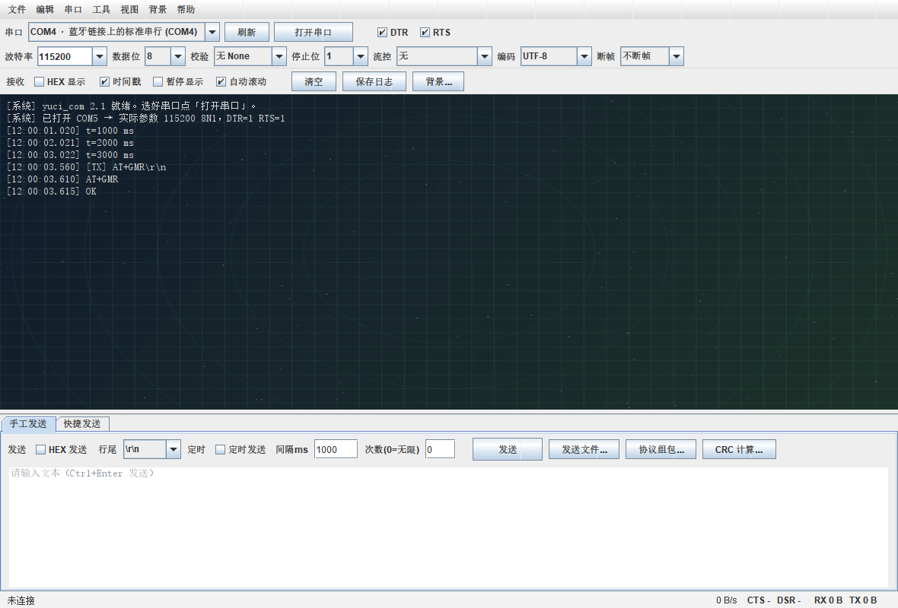
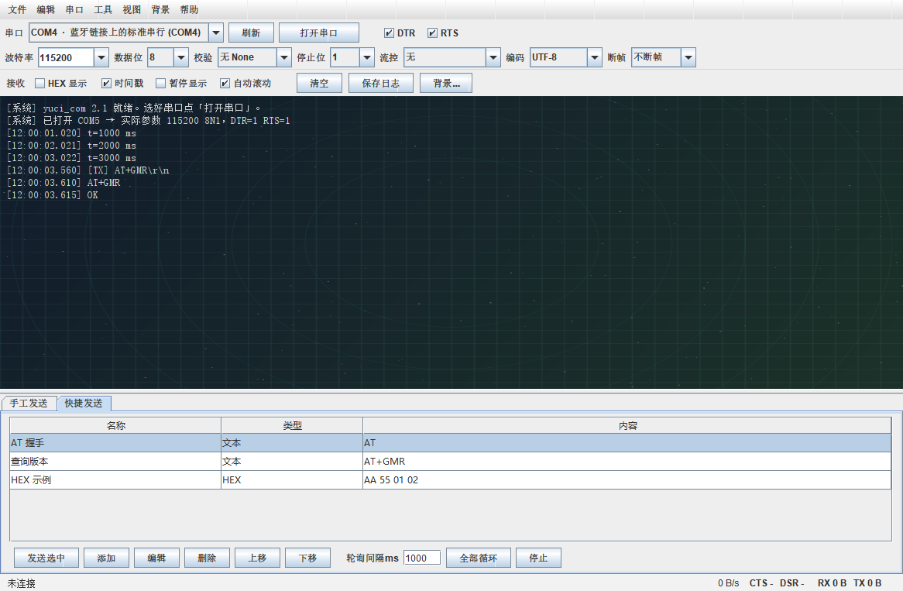

# yuci_com · 串口调试助手

一个用 **Java Swing + jSerialComm** 写的串口调试工具。不依赖浏览器、不起本地服务，双击就能用。
面向嵌入式 / 电控 / 单片机调试场景，兼顾「够用」和「好看」。





## 为什么又写一个串口助手

常见的串口工具要么是十几年前的老界面，要么安装包几百兆还带一堆广告。
`yuci_com` 想做的事情很朴素：**一个 exe、开箱即用、源码干净、可以自己改。**

- 单文件源码（`src/YuciCom.java`），零框架依赖，`javac` 一条命令就能编译
- 只依赖一个 jSerialComm（原生串口库，已内置）
- 运行时自带精简 JRE，目标机器不用装 Java

## 功能

**收发**
- 波特率 1200 ~ 3000000（可手输任意值）、数据位 5-8、校验 5 种、停止位 1/1.5/2、流控 4 种
- ASCII / HEX 双模式收发；HEX 显示 16 字节一行自动对齐，跨包不错列
- 时间戳、暂停显示、自动滚动锁定、一键清空
- 行尾自动追加 `\r\n` / `\n` / `\r`
- 定时发送（可设间隔与次数，0 = 无限循环）
- 文件分帧发送，可设每帧字节数与帧间隔，带进度条与停止按钮
- 发送历史（`Ctrl+↑` 取回上一条）
- DTR / RTS 手动置位，CTS / DSR 状态实时显示，支持发送 BREAK
- 热插拔检测：串口被拔掉会立即提示并关闭

**协议**
- 校验算法：SUM8、CRC8（0x07）、CRC8-MAXIM、CRC16-MODBUS、CRC16-CCITT
- 协议组包：自定义帧头、1 字节长度字段、数据、校验、帧尾，实时预览后直接发送

**快捷发送（多页发送）**
- 常用指令存成列表，双击即发
- 支持 HEX / 文本混排、独立行尾设置
- 一键「全部循环」按固定间隔轮询，适合跑长时间稳定性测试
- 列表保存在 `~/.yuci_com/quicksend.properties`，可自由增删排序

**显示**
- 字符编码：UTF-8 / GBK / GB18030 / GB2312 / ISO-8859-1 / US-ASCII
- 流式解码器会缓存半个汉字的字节，**UTF-8 中文被切成两包也不会出现乱码**
- 接收断帧：超过设定时间没有新数据自动换行，一眼看清一帧一帧的数据
- 接收区背景图：可选图片（或直接粘贴剪贴板截图），支持拉伸 / 等比 / 居中 / 平铺，遮罩浓度可调
- 字号 9~32 px，`Ctrl+滚轮` 实时缩放；字体可切中文优先 / 英文优先 / 界面字体
- 数据统计：收发字节、次数、平均速率、连接时长

**工程化**
- 所有配置持久化到 `~/.yuci_com/config.properties`，可导出/导入
- 内置自检：`--selftest` 覆盖 CRC 标准向量、HEX 解析、跨包解码、组包逻辑等 33 项
- 命令行抓包模式：`--headless --port COM5 --seconds 5`，方便写脚本自动化测试
- 真机验证过：STM32F103 + CH340 115200 8N1，心跳与回显均正常（见 CHANGELOG 2.1.1）

## 下载与运行

**方式一：直接用 exe（推荐）**

到 [Releases](../../releases) 下载 `yuci_com-2.1.1-win-x64.zip`，解压后双击 `yuci_com.exe`。
绿色版，不用安装，整个目录可以拷到 U 盘。

**方式二：跑 jar**

需要 Java 21+：

```bash
java -jar yuci_com.jar
```

**方式三：自己编译**

需要 JDK 21+（[Temurin](https://adoptium.net/) 或 Oracle JDK 都行）。

Windows：

```bat
build.bat          :: 编译 + 打包成 exe（输出 dist\yuci_com\yuci_com.exe）
build.bat jar      :: 只编译 jar（输出 build\jar\yuci_com.jar）
```

Linux / macOS：

```bash
./build.sh         # 编译并生成 build/jar/yuci_com.jar
./build.sh dist    # 额外用 jpackage 生成 app-image
```

Maven 用户：

```bash
mvn package        # 输出 target/yuci_com.jar
mvn package -Pdist # 额外生成 app-image
```

## 命令行

```text
--list                                       列出系统串口
--selftest                                   跑内置自检（CRC / HEX / 编码 / 组包）
--headless --port COM5 [--baud 115200] [--seconds 5] [--hex] [--out dump.txt]
                                             无界面抓 5 秒数据，可写到文件
```

示例：把开发板每秒打印的心跳存成文本

```bat
yuci_com.exe --headless --port COM5 --baud 115200 --seconds 10 --out heartbeat.txt
```

## 快捷键

| 快捷键 | 功能 | 快捷键 | 功能 |
| --- | --- | --- | --- |
| `Ctrl+Enter` | 发送 | `Ctrl+L` | 清空接收区 |
| `Ctrl+↑` | 取回上次发送内容 | `Ctrl+S` | 保存接收日志 |
| `Ctrl+O` | 打开 / 关闭串口 | `Ctrl+Shift+O` | 打开接收日志 |
| `Ctrl+R` | 重新打开串口 | `Ctrl+N` | 新建会话 |
| `Ctrl+1` / `Ctrl+2` | 手工发送 / 快捷发送 | `Ctrl+H` | HEX 显示开关 |
| `Ctrl+K` | CRC / 校验计算 | `Ctrl+Shift+T` | 时间戳开关 |
| `Ctrl+G` | 协议组包 | `Ctrl+P` | 暂停显示 |
| `Ctrl+B` | 选择背景图 | `Ctrl+T` | 数据统计 |
| `Ctrl+滚轮` | 调整字号 | `F5` / `F11` / `F1` | 刷新端口 / 最大化 / 帮助 |
| `Ctrl+Q` | 退出 | | |

## 接线提醒（新手最容易踩的坑）

USB-TTL 接 STM32 时：

| USB-TTL | 开发板 |
| --- | --- |
| TXD | PA10（USART1_RX） |
| RXD | PA9（USART1_TX） |
| GND | GND（**必须共地**） |
| 3V3 / 5V | **不要接**板子的 3V3 |

- TX 接 RX、RX 接 TX，交叉接，接反了收不到任何数据
- 开发板已经用 ST-Link / USB 供电时，不要再从 USB-TTL 取电
- 打开串口前先确认「设备管理器」里是 COM 几，再点「刷新」(F5)

## 配置文件

| 路径 | 内容 |
| --- | --- |
| `~/.yuci_com/config.properties` | 串口参数、编码、字号、背景图路径等 |
| `~/.yuci_com/quicksend.properties` | 快捷发送列表 |
| `~/.yuci_com/bg-clipboard.png` | 从剪贴板粘贴的背景图 |

删掉整个 `~/.yuci_com` 目录即可恢复出厂设置。

## 目录结构

```text
yuci_com/
├── src/YuciCom.java              全部源码（单文件，约 3.3k 行）
├── lib/jSerialComm-2.11.4.jar    唯一的第三方依赖
├── icon.png                      窗口图标（同时打进 jar）
├── yuci_com.ico                  exe 图标
├── docs/                         截图
├── build.bat                     Windows 构建脚本
├── build.sh                      Linux / macOS 构建脚本
├── pom.xml                       Maven 构建（可选）
└── .github/workflows/build.yml   CI：每次提交自动编译并跑自检
```

## 路线图

- [x] 收发 / HEX / 定时 / 文件发送
- [x] 5 种校验 + 协议组包
- [x] 快捷发送多页列表
- [x] 接收断帧、流式中文解码
- [x] 接收区背景图与遮罩
- [ ] 数据导入导出（CSV / Excel）
- [ ] 简易数据绘图（把收到的数字直接画成曲线）
- [ ] 多串口同时打开（分页）
- [ ] 脚本化发送（内置 JS 引擎跑自定义逻辑）

有新需求欢迎提 Issue，说清使用场景就行。

## 贡献

见 [CONTRIBUTING.md](CONTRIBUTING.md)。简单说：改代码 → 跑 `yuci_com --selftest` 全过 → 提 PR。

## 许可

[MIT](LICENSE) © yuci_com contributors

---

如果这个小工具帮你省了点时间，点个 Star 就好 ⭐
